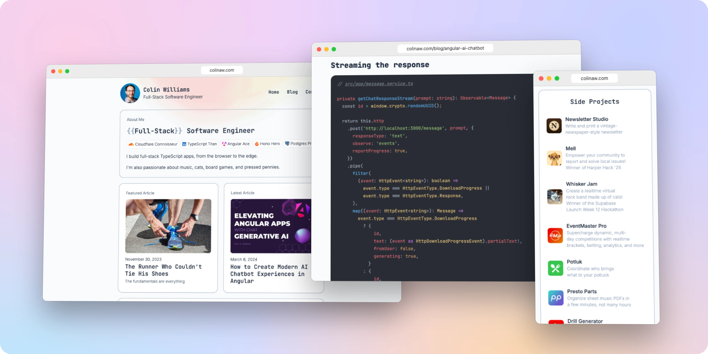

<h1 align="center">colinaw.com</h1>

<p align="center">My blog, resume, and project portfolio, all in 1!</p>

<div align="center">
  <a href="https://github.com/c-o-l-i-n/personal-website/actions/workflows/deploy.yml">
    
  </a>
  <a href="https://colinaw.com">
    
  </a>
</div>

<br />

<p align="center">
  <a href="https://colinaw.com">
    <picture>
      <source media="(prefers-color-scheme: dark)" srcset=".github/images/screenshot-dark.webp" />
      
    </picture>
  </a>
</p>

## About

This is the source for [colinaw.com](https://colinaw.com), my personal website. It has my blog, my resume, and some projects I've built. Blog posts are Markdown files, and every push to `main` deploys the site to Cloudflare Workers.

### Technology Stack

[](https://astro.build/)
[](https://www.typescriptlang.org/)
[](https://tailwindcss.com/)
[](https://bun.sh/)
[](https://workers.cloudflare.com/)

## Getting Started

### Prerequisites

- [Git](https://git-scm.com/)
- [Bun](https://bun.sh/)

### Install

```sh
git clone https://github.com/c-o-l-i-n/personal-website.git
cd personal-website
bun install
```

### Run

```sh
bun run dev
```

## Author

<a href="https://github.com/c-o-l-i-n">
  
</a>

**Colin A. Williams**

Website: [colinaw.com](https://colinaw.com)
<br>
Github: [@c-o-l-i-n](https://github.com/c-o-l-i-n)
